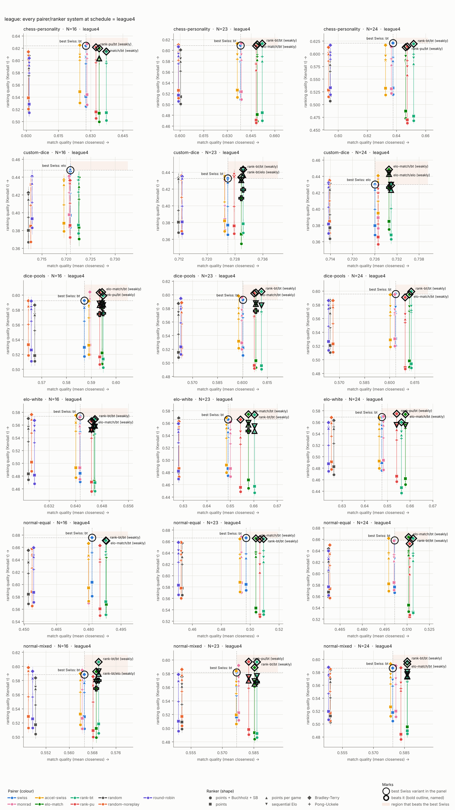

# Study: league

Weekly batches: 4 weeks, each player-week independently wants 0 games (10%),
2 (50%) or 3 (40%), about 8.8 games per player. All of a week's pairings are
made before any of its results are known. Compared with 9 ordinary rounds
(9 games each). Unmet demand and byes score 0 here, so rankers that use
points per game (pct, bt, elo) are the fair ones when game counts differ.

Tables: chess-personality, custom-dice, dice-pools, elo-white, normal-equal, normal-mixed. Trials per cell: 400. Bye value: 0.0 points. Seeding: random.

## Match quality vs ranking quality

Every pairer/ranker system at schedule = league4, with standard errors. Blue dot: standard Swiss (points, Buchholz, Sonneborn-Berger). Blue ring: the best Swiss variant in that cell (Swiss pairing with whichever ranker ranks best). The shaded quadrant is where a system must land to beat it. Orange dot: beats the best Swiss on both axes (paired |z| >= 3); orange ring: better on one axis, tied on the other.

## Against standard Swiss (swiss/swiss-tb)

Number of cells (out of 36) in each verdict. Per axis a system is better or worse than the reference when the paired difference has |z| >= 3, otherwise tied. *Dominates* = better on both axes; *weakly dominates* = better on one, tied on the other. Top 12 systems.

| system | dominates | weakly dominates | tie | trade-off | weakly dominated | dominated |
|---|---|---|---|---|---|---|
| rank-bt/bt | 18 | 6 | 12 | 0 | 0 | 0 |
| rank-bt/pu | 17 | 6 | 8 | 0 | 5 | 0 |
| rank-bt/elo | 17 | 3 | 10 | 3 | 3 | 0 |
| elo-match/bt | 17 | 2 | 17 | 0 | 0 | 0 |
| rank-bt/pct | 17 | 2 | 5 | 4 | 8 | 0 |
| elo-match/pu | 17 | 1 | 16 | 0 | 2 | 0 |
| elo-match/elo | 17 | 1 | 14 | 0 | 4 | 0 |
| elo-match/pct | 17 | 1 | 11 | 0 | 7 | 0 |
| rank-pu/bt | 12 | 6 | 16 | 0 | 2 | 0 |
| rank-pu/elo | 12 | 6 | 7 | 0 | 10 | 1 |
| rank-pu/pct | 12 | 6 | 6 | 0 | 11 | 1 |
| rank-pu/pu | 12 | 4 | 9 | 0 | 9 | 2 |

## Against the best Swiss variant in each cell (swiss/best)

Number of cells (out of 36) in each verdict. Per axis a system is better or worse than the reference when the paired difference has |z| >= 3, otherwise tied. *Dominates* = better on both axes; *weakly dominates* = better on one, tied on the other. Top 12 systems.

| system | dominates | weakly dominates | tie | trade-off | weakly dominated | dominated |
|---|---|---|---|---|---|---|
| rank-bt/bt | 0 | 22 | 14 | 0 | 0 | 0 |
| elo-match/bt | 0 | 17 | 19 | 0 | 0 | 0 |
| rank-pu/bt | 0 | 12 | 22 | 0 | 2 | 0 |
| rank-bt/elo | 0 | 11 | 8 | 11 | 6 | 0 |
| elo-match/elo | 0 | 10 | 14 | 7 | 5 | 0 |
| elo-match/pct | 0 | 10 | 8 | 7 | 11 | 0 |
| rank-bt/pu | 0 | 9 | 7 | 13 | 7 | 0 |
| rank-bt/pct | 0 | 8 | 6 | 14 | 8 | 0 |
| elo-match/pu | 0 | 6 | 13 | 11 | 6 | 0 |
| rank-bt/swiss-tb | 0 | 4 | 10 | 18 | 4 | 0 |
| rank-pu/elo | 0 | 4 | 10 | 8 | 13 | 1 |
| rank-pu/pct | 0 | 3 | 8 | 9 | 15 | 1 |

## Per cell: what beats the best Swiss

| table | N | schedule | seeding | best Swiss | beats it (Δτ, Δmq; * = weakly) |
|---|---|---|---|---|---|
| chess-personality | 16 | league4 | random | swiss/bt | rank-pu/bt* (-0.002, +0.005), elo-match/bt* (-0.004, +0.006), rank-bt/bt* (-0.009, +0.010) |
| chess-personality | 16 | rounds:9 | random | swiss/bt | — |
| chess-personality | 23 | league4 | random | swiss/bt | rank-bt/bt* (+0.004, +0.014), elo-match/bt* (+0.002, +0.011), rank-pu/bt* (-0.001, +0.010) |
| chess-personality | 23 | rounds:9 | random | swiss/bt | — |
| chess-personality | 24 | league4 | random | swiss/bt | rank-bt/bt* (-0.002, +0.014), rank-pu/bt* (-0.007, +0.010), elo-match/bt* (-0.009, +0.009) |
| chess-personality | 24 | rounds:9 | random | swiss/bt | rank-bt/bt* (+0.005, +0.007), rank-bt/pu* (-0.010, +0.007) |
| custom-dice | 16 | league4 | random | swiss/elo | — |
| custom-dice | 16 | rounds:9 | random | swiss/bt | — |
| custom-dice | 23 | league4 | random | swiss/bt | rank-bt/bt* (+0.010, +0.004), rank-bt/elo* (+0.010, +0.004), rank-bt/pct* (+0.004, +0.004) |
| custom-dice | 23 | rounds:9 | random | swiss/bt | — |
| custom-dice | 24 | league4 | random | swiss/elo | elo-match/bt* (+0.018, +0.004), elo-match/elo* (+0.014, +0.004), elo-match/pct* (+0.012, +0.004) |
| custom-dice | 24 | rounds:9 | random | swiss/swiss-tb | — |
| dice-pools | 16 | league4 | random | swiss/bt | elo-match/bt* (+0.011, +0.007), rank-pu/bt* (+0.011, +0.006), rank-bt/bt* (+0.006, +0.008) |
| dice-pools | 16 | rounds:9 | random | swiss/bt | — |
| dice-pools | 23 | league4 | random | swiss/bt | rank-bt/bt* (+0.012, +0.011), elo-match/bt* (+0.010, +0.008), rank-pu/bt* (+0.009, +0.007) |
| dice-pools | 23 | rounds:9 | random | swiss/bt | rank-bt/bt* (+0.009, +0.005), rank-bt/swiss-tb* (-0.002, +0.005), rank-bt/pu* (-0.009, +0.005) |
| dice-pools | 24 | league4 | random | swiss/bt | rank-bt/bt* (+0.004, +0.009), elo-match/bt* (-0.001, +0.008), rank-pu/bt* (-0.005, +0.006) |
| dice-pools | 24 | rounds:9 | random | swiss/bt | — |
| elo-white | 16 | league4 | random | swiss/bt | rank-bt/bt* (-0.005, +0.005), elo-match/bt* (-0.006, +0.004), rank-pu/bt* (-0.008, +0.003) |
| elo-white | 16 | rounds:9 | random | swiss/bt | — |
| elo-white | 23 | league4 | random | swiss/bt | elo-match/bt* (+0.008, +0.009), rank-bt/bt* (+0.007, +0.011), rank-pu/bt* (-0.001, +0.005) |
| elo-white | 23 | rounds:9 | random | swiss/bt | — |
| elo-white | 24 | league4 | random | swiss/bt | rank-pu/bt* (+0.005, +0.007), elo-match/bt* (+0.004, +0.010), rank-bt/bt* (-0.009, +0.009) |
| elo-white | 24 | rounds:9 | random | swiss/bt | — |
| normal-equal | 16 | league4 | random | swiss/bt | rank-bt/bt* (-0.005, +0.006), elo-match/bt* (-0.005, +0.007) |
| normal-equal | 16 | rounds:9 | random | swiss/bt | — |
| normal-equal | 23 | league4 | random | swiss/bt | elo-match/bt* (-0.001, +0.007), rank-bt/bt* (-0.002, +0.012), rank-pu/bt* (-0.002, +0.010) |
| normal-equal | 23 | rounds:9 | random | swiss/bt | rank-bt/bt* (+0.004, +0.007), rank-bt/pu* (-0.011, +0.007), rank-bt/swiss-tb* (-0.011, +0.007) |
| normal-equal | 24 | league4 | random | swiss/bt | elo-match/bt* (+0.005, +0.009), rank-bt/bt* (+0.003, +0.012), rank-pu/bt* (-0.006, +0.010) |
| normal-equal | 24 | rounds:9 | random | swiss/bt | rank-bt/bt* (+0.005, +0.008), rank-bt/pu* (-0.007, +0.008), rank-bt/swiss-tb* (-0.011, +0.008) |
| normal-mixed | 16 | league4 | random | swiss/bt | rank-bt/bt* (+0.018, +0.005), rank-bt/elo* (+0.005, +0.005), elo-match/bt* (+0.004, +0.004) |
| normal-mixed | 16 | rounds:9 | random | swiss/bt | — |
| normal-mixed | 23 | league4 | random | swiss/bt | rank-pu/bt* (+0.016, +0.006), rank-bt/bt* (+0.015, +0.010), elo-match/bt* (+0.007, +0.009) |
| normal-mixed | 23 | rounds:9 | random | swiss/bt | — |
| normal-mixed | 24 | league4 | random | swiss/bt | rank-bt/bt* (+0.011, +0.007), elo-match/bt* (+0.006, +0.007), rank-bt/elo* (-0.006, +0.007) |
| normal-mixed | 24 | rounds:9 | random | swiss/bt | rank-bt/bt* (+0.013, +0.006), rank-bt/swiss-tb* (-0.004, +0.006), rank-bt/pu* (-0.008, +0.006) |

## Pareto frontier per cell (by means)

| table | n | schedule | seeding | system | mq | tau | topq | win |
|---|---|---|---|---|---|---|---|---|
| chess-personality | 16 | league4 | random | monrad/bt | 0.628 | 0.627 | 0.581 | 0.250 |
| chess-personality | 16 | league4 | random | rank-pu/bt | 0.633 | 0.621 | 0.570 | 0.235 |
| chess-personality | 16 | league4 | random | elo-match/bt | 0.634 | 0.619 | 0.578 | 0.233 |
| chess-personality | 16 | league4 | random | rank-bt/bt | 0.637 | 0.614 | 0.560 | 0.245 |
| chess-personality | 16 | rounds:9 | random | rank-pu/bt | 0.641 | 0.638 | 0.588 | 0.235 |
| chess-personality | 16 | rounds:9 | random | elo-match/bt | 0.645 | 0.635 | 0.589 | 0.235 |
| chess-personality | 23 | league4 | random | monrad/bt | 0.639 | 0.613 | 0.544 | 0.195 |
| chess-personality | 23 | league4 | random | rank-bt/bt | 0.652 | 0.613 | 0.542 | 0.205 |
| chess-personality | 23 | rounds:9 | random | swiss/bt | 0.671 | 0.623 | 0.565 | 0.207 |
| chess-personality | 23 | rounds:9 | random | monrad/bt | 0.671 | 0.619 | 0.530 | 0.223 |
| chess-personality | 23 | rounds:9 | random | rank-bt/bt | 0.673 | 0.612 | 0.526 | 0.217 |
| chess-personality | 24 | league4 | random | swiss/bt | 0.638 | 0.621 | 0.585 | 0.185 |
| chess-personality | 24 | league4 | random | rank-bt/bt | 0.652 | 0.619 | 0.587 | 0.223 |
| chess-personality | 24 | rounds:9 | random | rank-bt/bt | 0.668 | 0.631 | 0.580 | 0.198 |
| custom-dice | 16 | league4 | random | swiss/elo | 0.721 | 0.448 | 0.549 | 0.320 |
| custom-dice | 16 | league4 | random | elo-match/bt | 0.723 | 0.440 | 0.548 | 0.323 |
| custom-dice | 16 | rounds:9 | random | monrad/swiss-tb | 0.731 | 0.452 | 0.554 | 0.310 |
| custom-dice | 16 | rounds:9 | random | swiss/bt | 0.732 | 0.451 | 0.552 | 0.320 |
| custom-dice | 23 | league4 | random | rank-bt/bt | 0.730 | 0.443 | 0.537 | 0.280 |
| custom-dice | 23 | rounds:9 | random | elo-match/bt | 0.734 | 0.447 | 0.553 | 0.307 |
| custom-dice | 23 | rounds:9 | random | monrad/swiss-tb | 0.735 | 0.445 | 0.524 | 0.315 |
| custom-dice | 24 | league4 | random | elo-match/bt | 0.730 | 0.448 | 0.556 | 0.258 |
| custom-dice | 24 | league4 | random | rank-bt/elo | 0.730 | 0.430 | 0.560 | 0.297 |
| custom-dice | 24 | rounds:9 | random | round-robin/swiss-tb | 0.713 | 0.449 | 0.563 | 0.245 |
| custom-dice | 24 | rounds:9 | random | accel-swiss/swiss-tb | 0.736 | 0.447 | 0.565 | 0.278 |
| custom-dice | 24 | rounds:9 | random | swiss/swiss-tb | 0.738 | 0.446 | 0.559 | 0.285 |
| dice-pools | 16 | league4 | random | elo-match/bt | 0.594 | 0.604 | 0.667 | 0.352 |
| dice-pools | 16 | league4 | random | rank-bt/bt | 0.595 | 0.599 | 0.662 | 0.357 |
| dice-pools | 16 | rounds:9 | random | accel-swiss/bt | 0.604 | 0.617 | 0.681 | 0.372 |
| dice-pools | 16 | rounds:9 | random | monrad/bt | 0.606 | 0.616 | 0.661 | 0.393 |
| dice-pools | 23 | league4 | random | rank-bt/bt | 0.611 | 0.605 | 0.645 | 0.273 |
| dice-pools | 23 | rounds:9 | random | elo-match/bt | 0.626 | 0.609 | 0.653 | 0.275 |
| dice-pools | 23 | rounds:9 | random | rank-bt/bt | 0.628 | 0.606 | 0.646 | 0.287 |
| dice-pools | 24 | league4 | random | rank-bt/bt | 0.613 | 0.599 | 0.665 | 0.312 |
| dice-pools | 24 | rounds:9 | random | rank-bt/bt | 0.631 | 0.613 | 0.677 | 0.275 |
| elo-white | 16 | league4 | random | random-noreplay/bt | 0.627 | 0.576 | 0.679 | 0.475 |
| elo-white | 16 | league4 | random | accel-swiss/bt | 0.640 | 0.575 | 0.681 | 0.585 |
| elo-white | 16 | league4 | random | swiss/bt | 0.641 | 0.574 | 0.699 | 0.540 |
| elo-white | 16 | league4 | random | rank-bt/bt | 0.646 | 0.569 | 0.699 | 0.557 |
| elo-white | 16 | rounds:9 | random | swiss/bt | 0.653 | 0.595 | 0.701 | 0.557 |
| elo-white | 16 | rounds:9 | random | elo-match/bt | 0.655 | 0.588 | 0.705 | 0.555 |
| elo-white | 23 | league4 | random | elo-match/bt | 0.658 | 0.574 | 0.696 | 0.497 |
| elo-white | 23 | league4 | random | rank-bt/bt | 0.660 | 0.573 | 0.688 | 0.540 |
| elo-white | 23 | rounds:9 | random | accel-swiss/bt | 0.663 | 0.585 | 0.695 | 0.542 |
| elo-white | 23 | rounds:9 | random | rank-pu/bt | 0.664 | 0.580 | 0.692 | 0.570 |
| elo-white | 23 | rounds:9 | random | swiss/bt | 0.666 | 0.576 | 0.697 | 0.512 |
| elo-white | 23 | rounds:9 | random | rank-bt/bt | 0.668 | 0.570 | 0.685 | 0.590 |
| elo-white | 24 | league4 | random | rank-pu/bt | 0.654 | 0.574 | 0.699 | 0.515 |
| elo-white | 24 | league4 | random | elo-match/bt | 0.658 | 0.573 | 0.703 | 0.502 |
| elo-white | 24 | rounds:9 | random | elo-match/bt | 0.670 | 0.593 | 0.712 | 0.502 |
| normal-equal | 16 | league4 | random | swiss/bt | 0.482 | 0.675 | 0.747 | 0.555 |
| normal-equal | 16 | league4 | random | rank-bt/bt | 0.488 | 0.671 | 0.738 | 0.603 |
| normal-equal | 16 | league4 | random | elo-match/bt | 0.488 | 0.670 | 0.744 | 0.583 |
| normal-equal | 16 | rounds:9 | random | elo-match/bt | 0.497 | 0.684 | 0.749 | 0.642 |
| normal-equal | 16 | rounds:9 | random | accel-swiss/bt | 0.497 | 0.682 | 0.767 | 0.637 |
| normal-equal | 16 | rounds:9 | random | swiss/bt | 0.498 | 0.681 | 0.751 | 0.598 |
| normal-equal | 23 | league4 | random | monrad/bt | 0.494 | 0.667 | 0.713 | 0.542 |
| normal-equal | 23 | league4 | random | swiss/bt | 0.497 | 0.666 | 0.720 | 0.595 |
| normal-equal | 23 | league4 | random | elo-match/bt | 0.504 | 0.665 | 0.725 | 0.562 |
| normal-equal | 23 | league4 | random | rank-bt/bt | 0.509 | 0.664 | 0.733 | 0.620 |
| normal-equal | 23 | rounds:9 | random | monrad/bt | 0.521 | 0.678 | 0.733 | 0.590 |
| normal-equal | 23 | rounds:9 | random | rank-bt/bt | 0.530 | 0.676 | 0.737 | 0.588 |
| normal-equal | 24 | league4 | random | elo-match/bt | 0.511 | 0.663 | 0.737 | 0.557 |
| normal-equal | 24 | league4 | random | rank-bt/bt | 0.514 | 0.661 | 0.733 | 0.522 |
| normal-equal | 24 | rounds:9 | random | rank-bt/bt | 0.537 | 0.681 | 0.754 | 0.637 |
| normal-mixed | 16 | league4 | random | rank-bt/bt | 0.570 | 0.606 | 0.666 | 0.510 |
| normal-mixed | 16 | rounds:9 | random | rank-pu/bt | 0.576 | 0.613 | 0.666 | 0.522 |
| normal-mixed | 16 | rounds:9 | random | rank-bt/bt | 0.578 | 0.612 | 0.673 | 0.475 |
| normal-mixed | 16 | rounds:9 | random | swiss/bt | 0.578 | 0.607 | 0.683 | 0.490 |
| normal-mixed | 23 | league4 | random | rank-pu/bt | 0.583 | 0.597 | 0.647 | 0.520 |
| normal-mixed | 23 | league4 | random | rank-bt/bt | 0.587 | 0.597 | 0.639 | 0.520 |
| normal-mixed | 23 | rounds:9 | random | monrad/bt | 0.596 | 0.600 | 0.665 | 0.510 |
| normal-mixed | 23 | rounds:9 | random | rank-bt/bt | 0.598 | 0.594 | 0.648 | 0.537 |
| normal-mixed | 23 | rounds:9 | random | elo-match/bt | 0.598 | 0.593 | 0.645 | 0.540 |
| normal-mixed | 24 | league4 | random | rank-bt/bt | 0.586 | 0.597 | 0.660 | 0.490 |
| normal-mixed | 24 | rounds:9 | random | rank-bt/bt | 0.602 | 0.612 | 0.679 | 0.537 |
