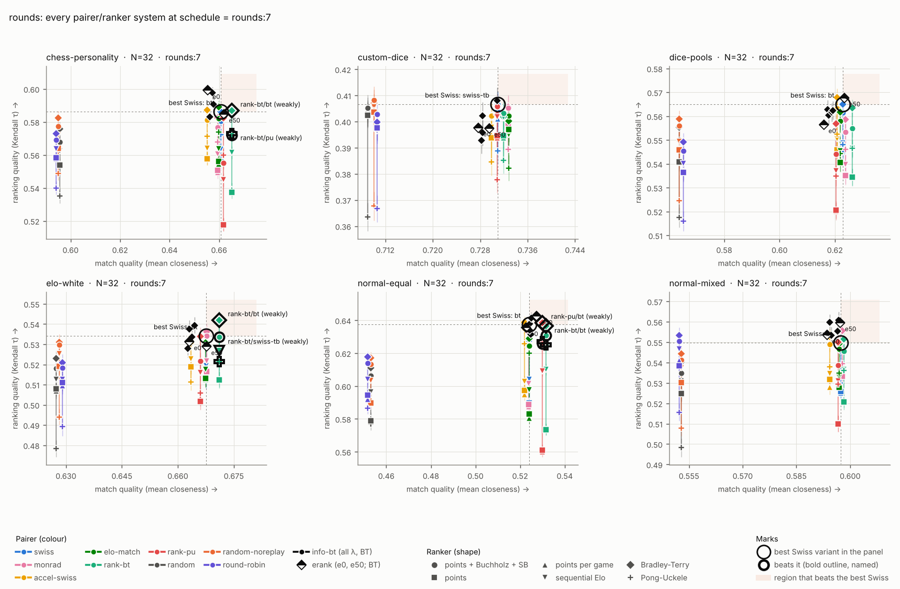
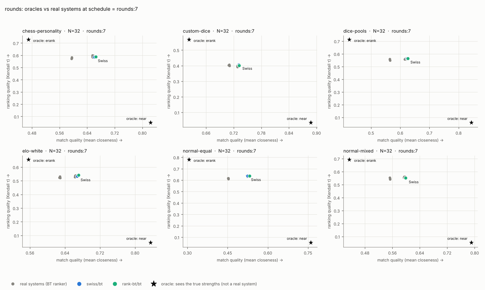
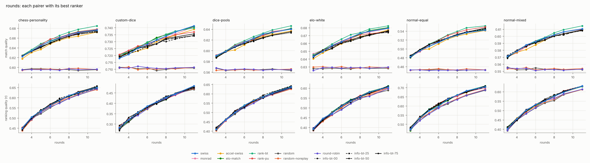
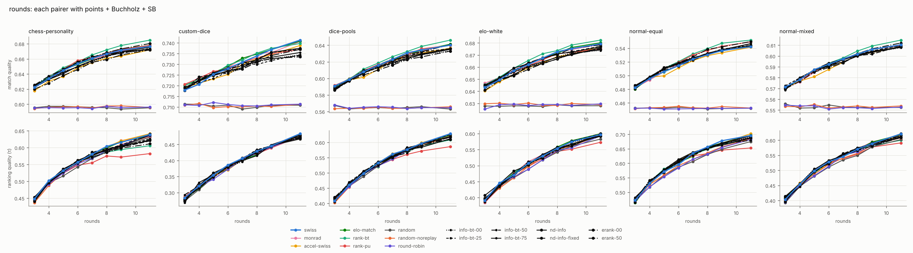

# Study: rounds

How do match quality and ranking quality change with the number of rounds?
32 players drawn from each table, 3 to 11 classic rounds, everyone plays every
round (no byes).

Tables: chess-personality, custom-dice, dice-pools, elo-white, normal-equal, normal-mixed. Trials per cell: 400. Bye value: 1.0 points. Seeding: random.

## Match quality vs ranking quality

Every pairer/ranker system at schedule = rounds:7, with standard errors. Blue dot: standard Swiss (points, Buchholz, Sonneborn-Berger). Blue ring: the best Swiss variant in that cell (Swiss pairing with whichever ranker ranks best). The shaded quadrant is where a system must land to beat it. Orange dot: beats the best Swiss on both axes (paired |z| >= 3); orange ring: better on one axis, tied on the other.

## Headroom: oracle pairers

Two oracles that see the true strengths (not real systems, so they are left out of every verdict, frontier and the main plot): `oracle-near` pairs true neighbours (the closest games possible); `oracle-erank` picks the games expected to move the Bradley-Terry fit furthest toward the true order. They bracket what pairing alone could do on each axis.

## Sweep

Each pairer ranked by its best ranker in that cell:

Each pairer ranked by points + Buchholz + SB:

## Against standard Swiss (swiss/swiss-tb)

Number of cells (out of 48) in each verdict. Per axis a system is better or worse than the reference when the paired difference has |z| >= 3, otherwise tied. *Dominates* = better on both axes; *weakly dominates* = better on one, tied on the other. Top 12 systems.

| system | dominates | weakly dominates | tie | trade-off | weakly dominated | dominated |
|---|---|---|---|---|---|---|
| rank-bt/bt | 1 | 13 | 34 | 0 | 0 | 0 |
| erank-50/bt | 1 | 6 | 40 | 0 | 1 | 0 |
| rank-pu/bt | 1 | 6 | 39 | 0 | 2 | 0 |
| info-bt-75/bt | 1 | 2 | 35 | 0 | 10 | 0 |
| swiss/bt | 0 | 25 | 23 | 0 | 0 | 0 |
| rank-bt/pu | 0 | 12 | 24 | 2 | 10 | 0 |
| rank-bt/swiss-tb | 0 | 7 | 34 | 7 | 0 | 0 |
| erank-50/pu | 0 | 5 | 34 | 0 | 8 | 1 |
| erank-50/swiss-tb | 0 | 4 | 39 | 1 | 4 | 0 |
| rank-pu/pu | 0 | 4 | 18 | 2 | 22 | 2 |
| info-bt-25/bt | 0 | 3 | 32 | 2 | 11 | 0 |
| rank-pu/swiss-tb | 0 | 3 | 29 | 3 | 12 | 1 |

## Against the best Swiss variant in each cell (swiss/best)

Number of cells (out of 48) in each verdict. Per axis a system is better or worse than the reference when the paired difference has |z| >= 3, otherwise tied. *Dominates* = better on both axes; *weakly dominates* = better on one, tied on the other. Top 12 systems.

| system | dominates | weakly dominates | tie | trade-off | weakly dominated | dominated |
|---|---|---|---|---|---|---|
| rank-pu/bt | 1 | 5 | 40 | 0 | 2 | 0 |
| rank-bt/bt | 0 | 14 | 34 | 0 | 0 | 0 |
| erank-50/bt | 0 | 6 | 41 | 0 | 1 | 0 |
| rank-bt/swiss-tb | 0 | 6 | 32 | 8 | 2 | 0 |
| rank-bt/pu | 0 | 6 | 22 | 8 | 12 | 0 |
| rank-pu/swiss-tb | 0 | 3 | 28 | 3 | 13 | 1 |
| erank-50/pu | 0 | 3 | 25 | 2 | 17 | 1 |
| rank-pu/pu | 0 | 3 | 13 | 3 | 27 | 2 |
| erank-50/swiss-tb | 0 | 2 | 36 | 3 | 7 | 0 |
| info-bt-75/bt | 0 | 1 | 37 | 0 | 10 | 0 |
| info-bt-25/bt | 0 | 1 | 34 | 0 | 13 | 0 |
| info-bt-50/bt | 0 | 1 | 34 | 0 | 13 | 0 |

## Per cell: what beats the best Swiss

| table | N | schedule | seeding | best Swiss | beats it (Δτ, Δmq; * = weakly) |
|---|---|---|---|---|---|
| chess-personality | 32 | rounds:11 | random | swiss/bt | erank-50/bt* (-0.000, +0.004), rank-bt/bt* (-0.001, +0.008) |
| chess-personality | 32 | rounds:3 | random | swiss/bt | — |
| chess-personality | 32 | rounds:4 | random | swiss/bt | — |
| chess-personality | 32 | rounds:5 | random | swiss/bt | — |
| chess-personality | 32 | rounds:6 | random | swiss/bt | rank-pu/bt* (+0.005, +0.004), rank-pu/pu* (-0.011, +0.004), rank-pu/swiss-tb* (-0.014, +0.004) |
| chess-personality | 32 | rounds:7 | random | swiss/bt | rank-bt/bt* (+0.001, +0.004), rank-bt/pu* (-0.013, +0.004), rank-bt/swiss-tb* (-0.014, +0.004) |
| chess-personality | 32 | rounds:8 | random | swiss/bt | rank-bt/bt* (-0.004, +0.005) |
| chess-personality | 32 | rounds:9 | random | swiss/bt | rank-bt/bt* (-0.003, +0.006) |
| custom-dice | 32 | rounds:11 | random | swiss/bt | — |
| custom-dice | 32 | rounds:3 | random | swiss/swiss-tb | — |
| custom-dice | 32 | rounds:4 | random | swiss/swiss-tb | — |
| custom-dice | 32 | rounds:5 | random | swiss/swiss-tb | — |
| custom-dice | 32 | rounds:6 | random | swiss/swiss-tb | — |
| custom-dice | 32 | rounds:7 | random | swiss/swiss-tb | — |
| custom-dice | 32 | rounds:8 | random | swiss/swiss-tb | — |
| custom-dice | 32 | rounds:9 | random | swiss/swiss-tb | — |
| dice-pools | 32 | rounds:11 | random | swiss/bt | rank-bt/bt* (+0.004, +0.006) |
| dice-pools | 32 | rounds:3 | random | swiss/bt | — |
| dice-pools | 32 | rounds:4 | random | swiss/bt | — |
| dice-pools | 32 | rounds:5 | random | swiss/bt | — |
| dice-pools | 32 | rounds:6 | random | swiss/bt | — |
| dice-pools | 32 | rounds:7 | random | swiss/bt | — |
| dice-pools | 32 | rounds:8 | random | swiss/bt | — |
| dice-pools | 32 | rounds:9 | random | swiss/bt | rank-bt/bt* (+0.004, +0.004) |
| elo-white | 32 | rounds:11 | random | swiss/bt | rank-bt/bt* (+0.006, +0.003), rank-bt/swiss-tb* (-0.012, +0.003), rank-bt/pu* (-0.014, +0.003) |
| elo-white | 32 | rounds:3 | random | swiss/bt | — |
| elo-white | 32 | rounds:4 | random | swiss/bt | — |
| elo-white | 32 | rounds:5 | random | swiss/bt | — |
| elo-white | 32 | rounds:6 | random | swiss/bt | — |
| elo-white | 32 | rounds:7 | random | swiss/bt | rank-bt/bt* (+0.008, +0.004), rank-bt/swiss-tb* (-0.001, +0.004), rank-bt/elo* (-0.007, +0.004) |
| elo-white | 32 | rounds:8 | random | swiss/bt | — |
| elo-white | 32 | rounds:9 | random | swiss/bt | — |
| normal-equal | 32 | rounds:11 | random | swiss/bt | erank-50/bt* (+0.008, +0.008), rank-bt/bt* (+0.005, +0.010), info-bt-75/bt* (+0.005, +0.005) |
| normal-equal | 32 | rounds:3 | random | swiss/bt | — |
| normal-equal | 32 | rounds:4 | random | swiss/bt | — |
| normal-equal | 32 | rounds:5 | random | swiss/bt | erank-50/bt* (+0.004, +0.006), erank-50/swiss-tb* (+0.001, +0.006), erank-50/pu* (-0.004, +0.006) |
| normal-equal | 32 | rounds:6 | random | swiss/bt | rank-pu/bt (+0.017, +0.005), info-bt-25/bt* (+0.018, +0.004), info-bt-00/bt* (+0.015, +0.004) |
| normal-equal | 32 | rounds:7 | random | swiss/bt | rank-pu/bt* (+0.001, +0.006), rank-bt/bt* (-0.001, +0.007), rank-bt/swiss-tb* (-0.007, +0.007) |
| normal-equal | 32 | rounds:8 | random | swiss/bt | erank-50/bt* (+0.007, +0.008), rank-bt/bt* (-0.001, +0.009), erank-50/swiss-tb* (-0.003, +0.008) |
| normal-equal | 32 | rounds:9 | random | swiss/bt | rank-bt/bt* (-0.000, +0.011), erank-50/bt* (-0.002, +0.005), rank-pu/bt* (-0.006, +0.006) |
| normal-mixed | 32 | rounds:11 | random | swiss/bt | rank-bt/bt* (-0.004, +0.004) |
| normal-mixed | 32 | rounds:3 | random | swiss/swiss-tb | — |
| normal-mixed | 32 | rounds:4 | random | swiss/bt | — |
| normal-mixed | 32 | rounds:5 | random | swiss/bt | — |
| normal-mixed | 32 | rounds:6 | random | swiss/bt | — |
| normal-mixed | 32 | rounds:7 | random | swiss/bt | — |
| normal-mixed | 32 | rounds:8 | random | swiss/bt | — |
| normal-mixed | 32 | rounds:9 | random | swiss/bt | — |

## Pareto frontier per cell (by means)

| table | n | schedule | seeding | system | mq | tau | topq | win |
|---|---|---|---|---|---|---|---|---|
| chess-personality | 32 | rounds:11 | random | info-bt-25/bt | 0.674 | 0.658 | 0.597 | 0.155 |
| chess-personality | 32 | rounds:11 | random | info-bt-75/bt | 0.675 | 0.654 | 0.589 | 0.172 |
| chess-personality | 32 | rounds:11 | random | elo-match/bt | 0.678 | 0.653 | 0.599 | 0.175 |
| chess-personality | 32 | rounds:11 | random | erank-50/bt | 0.680 | 0.650 | 0.596 | 0.160 |
| chess-personality | 32 | rounds:11 | random | rank-bt/bt | 0.685 | 0.649 | 0.591 | 0.155 |
| chess-personality | 32 | rounds:3 | random | accel-swiss/bt | 0.618 | 0.453 | 0.474 | 0.113 |
| chess-personality | 32 | rounds:3 | random | rank-pu/bt | 0.624 | 0.453 | 0.497 | 0.100 |
| chess-personality | 32 | rounds:3 | random | elo-match/bt | 0.624 | 0.452 | 0.489 | 0.102 |
| chess-personality | 32 | rounds:3 | random | rank-bt/bt | 0.624 | 0.451 | 0.480 | 0.102 |
| chess-personality | 32 | rounds:3 | random | erank-50/bt | 0.625 | 0.449 | 0.472 | 0.072 |
| chess-personality | 32 | rounds:4 | random | swiss/bt | 0.634 | 0.504 | 0.513 | 0.090 |
| chess-personality | 32 | rounds:4 | random | erank-50/bt | 0.637 | 0.502 | 0.507 | 0.145 |
| chess-personality | 32 | rounds:5 | random | erank-50/bt | 0.646 | 0.542 | 0.527 | 0.140 |
| chess-personality | 32 | rounds:5 | random | rank-bt/bt | 0.648 | 0.536 | 0.529 | 0.113 |
| chess-personality | 32 | rounds:6 | random | info-bt-75/bt | 0.650 | 0.569 | 0.543 | 0.115 |
| chess-personality | 32 | rounds:6 | random | erank-50/bt | 0.655 | 0.567 | 0.547 | 0.147 |
| chess-personality | 32 | rounds:6 | random | rank-pu/bt | 0.658 | 0.566 | 0.547 | 0.160 |
| chess-personality | 32 | rounds:7 | random | erank-00/bt | 0.655 | 0.599 | 0.562 | 0.163 |
| chess-personality | 32 | rounds:7 | random | info-bt-25/bt | 0.657 | 0.598 | 0.562 | 0.140 |
| chess-personality | 32 | rounds:7 | random | info-bt-75/bt | 0.658 | 0.591 | 0.557 | 0.152 |
| chess-personality | 32 | rounds:7 | random | info-bt-50/bt | 0.658 | 0.591 | 0.562 | 0.160 |
| chess-personality | 32 | rounds:7 | random | elo-match/bt | 0.660 | 0.589 | 0.562 | 0.122 |
| chess-personality | 32 | rounds:7 | random | rank-bt/bt | 0.665 | 0.587 | 0.544 | 0.150 |
| chess-personality | 32 | rounds:8 | random | info-bt-00/bt | 0.663 | 0.612 | 0.571 | 0.155 |
| chess-personality | 32 | rounds:8 | random | rank-pu/bt | 0.668 | 0.612 | 0.565 | 0.150 |
| chess-personality | 32 | rounds:8 | random | elo-match/bt | 0.668 | 0.608 | 0.580 | 0.165 |
| chess-personality | 32 | rounds:8 | random | rank-bt/bt | 0.672 | 0.607 | 0.568 | 0.152 |
| chess-personality | 32 | rounds:9 | random | monrad/bt | 0.671 | 0.631 | 0.584 | 0.182 |
| chess-personality | 32 | rounds:9 | random | elo-match/bt | 0.673 | 0.628 | 0.578 | 0.163 |
| chess-personality | 32 | rounds:9 | random | erank-50/bt | 0.673 | 0.625 | 0.578 | 0.160 |
| chess-personality | 32 | rounds:9 | random | rank-bt/bt | 0.678 | 0.622 | 0.576 | 0.140 |
| custom-dice | 32 | rounds:11 | random | swiss/bt | 0.741 | 0.484 | 0.588 | 0.315 |
| custom-dice | 32 | rounds:3 | random | info-bt-50/bt | 0.718 | 0.293 | 0.441 | 0.140 |
| custom-dice | 32 | rounds:3 | random | rank-pu/bt | 0.721 | 0.287 | 0.443 | 0.128 |
| custom-dice | 32 | rounds:4 | random | info-bt-75/swiss-tb | 0.722 | 0.331 | 0.476 | 0.138 |
| custom-dice | 32 | rounds:4 | random | rank-pu/swiss-tb | 0.723 | 0.323 | 0.475 | 0.142 |
| custom-dice | 32 | rounds:4 | random | monrad/swiss-tb | 0.724 | 0.321 | 0.477 | 0.150 |
| custom-dice | 32 | rounds:5 | random | info-bt-25/swiss-tb | 0.723 | 0.359 | 0.508 | 0.203 |
| custom-dice | 32 | rounds:5 | random | erank-50/swiss-tb | 0.726 | 0.356 | 0.487 | 0.210 |
| custom-dice | 32 | rounds:5 | random | monrad/swiss-tb | 0.726 | 0.354 | 0.486 | 0.203 |
| custom-dice | 32 | rounds:5 | random | rank-pu/bt | 0.727 | 0.349 | 0.488 | 0.235 |
| custom-dice | 32 | rounds:6 | random | swiss/swiss-tb | 0.728 | 0.386 | 0.502 | 0.160 |
| custom-dice | 32 | rounds:6 | random | rank-bt/swiss-tb | 0.730 | 0.380 | 0.514 | 0.223 |
| custom-dice | 32 | rounds:7 | random | random-noreplay/swiss-tb | 0.710 | 0.408 | 0.535 | 0.223 |
| custom-dice | 32 | rounds:7 | random | info-bt-25/bt | 0.731 | 0.408 | 0.539 | 0.245 |
| custom-dice | 32 | rounds:7 | random | swiss/swiss-tb | 0.731 | 0.407 | 0.541 | 0.230 |
| custom-dice | 32 | rounds:7 | random | monrad/bt | 0.733 | 0.406 | 0.525 | 0.275 |
| custom-dice | 32 | rounds:7 | random | elo-match/swiss-tb | 0.733 | 0.402 | 0.537 | 0.270 |
| custom-dice | 32 | rounds:8 | random | info-bt-25/swiss-tb | 0.730 | 0.434 | 0.548 | 0.258 |
| custom-dice | 32 | rounds:8 | random | info-bt-50/swiss-tb | 0.732 | 0.432 | 0.546 | 0.245 |
| custom-dice | 32 | rounds:8 | random | swiss/swiss-tb | 0.734 | 0.429 | 0.550 | 0.263 |
| custom-dice | 32 | rounds:8 | random | monrad/swiss-tb | 0.735 | 0.425 | 0.542 | 0.280 |
| custom-dice | 32 | rounds:8 | random | rank-bt/swiss-tb | 0.735 | 0.421 | 0.546 | 0.270 |
| custom-dice | 32 | rounds:9 | random | info-bt-75/swiss-tb | 0.733 | 0.449 | 0.567 | 0.285 |
| custom-dice | 32 | rounds:9 | random | swiss/swiss-tb | 0.737 | 0.445 | 0.567 | 0.268 |
| custom-dice | 32 | rounds:9 | random | rank-bt/swiss-tb | 0.737 | 0.444 | 0.568 | 0.263 |
| dice-pools | 32 | rounds:11 | random | info-bt-25/bt | 0.635 | 0.642 | 0.709 | 0.258 |
| dice-pools | 32 | rounds:11 | random | rank-bt/bt | 0.646 | 0.640 | 0.705 | 0.282 |
| dice-pools | 32 | rounds:3 | random | erank-50/swiss-tb | 0.588 | 0.420 | 0.527 | 0.130 |
| dice-pools | 32 | rounds:3 | random | rank-pu/bt | 0.592 | 0.418 | 0.515 | 0.145 |
| dice-pools | 32 | rounds:4 | random | erank-00/bt | 0.597 | 0.467 | 0.577 | 0.155 |
| dice-pools | 32 | rounds:4 | random | erank-50/bt | 0.599 | 0.466 | 0.570 | 0.188 |
| dice-pools | 32 | rounds:4 | random | elo-match/bt | 0.600 | 0.461 | 0.558 | 0.165 |
| dice-pools | 32 | rounds:4 | random | monrad/bt | 0.600 | 0.458 | 0.568 | 0.158 |
| dice-pools | 32 | rounds:5 | random | info-bt-50/bt | 0.607 | 0.509 | 0.598 | 0.212 |
| dice-pools | 32 | rounds:5 | random | rank-pu/bt | 0.609 | 0.508 | 0.596 | 0.175 |
| dice-pools | 32 | rounds:5 | random | rank-bt/bt | 0.611 | 0.505 | 0.595 | 0.177 |
| dice-pools | 32 | rounds:6 | random | erank-50/bt | 0.616 | 0.540 | 0.623 | 0.217 |
| dice-pools | 32 | rounds:6 | random | rank-bt/bt | 0.618 | 0.539 | 0.623 | 0.207 |
| dice-pools | 32 | rounds:7 | random | accel-swiss/bt | 0.621 | 0.568 | 0.640 | 0.207 |
| dice-pools | 32 | rounds:7 | random | erank-50/bt | 0.623 | 0.568 | 0.647 | 0.233 |
| dice-pools | 32 | rounds:7 | random | rank-bt/bt | 0.626 | 0.563 | 0.635 | 0.210 |
| dice-pools | 32 | rounds:8 | random | info-bt-25/bt | 0.625 | 0.593 | 0.673 | 0.242 |
| dice-pools | 32 | rounds:8 | random | erank-50/bt | 0.628 | 0.591 | 0.658 | 0.233 |
| dice-pools | 32 | rounds:8 | random | rank-pu/bt | 0.629 | 0.584 | 0.656 | 0.225 |
| dice-pools | 32 | rounds:8 | random | swiss/bt | 0.631 | 0.583 | 0.656 | 0.285 |
| dice-pools | 32 | rounds:8 | random | rank-bt/bt | 0.632 | 0.583 | 0.666 | 0.230 |
| dice-pools | 32 | rounds:9 | random | erank-50/bt | 0.632 | 0.611 | 0.688 | 0.233 |
| dice-pools | 32 | rounds:9 | random | rank-bt/bt | 0.639 | 0.608 | 0.690 | 0.215 |
| elo-white | 32 | rounds:11 | random | rank-bt/bt | 0.682 | 0.611 | 0.738 | 0.580 |
| elo-white | 32 | rounds:3 | random | erank-50/bt | 0.644 | 0.399 | 0.550 | 0.235 |
| elo-white | 32 | rounds:3 | random | rank-bt/bt | 0.645 | 0.387 | 0.538 | 0.260 |
| elo-white | 32 | rounds:3 | random | monrad/swiss-tb | 0.647 | 0.384 | 0.551 | 0.230 |
| elo-white | 32 | rounds:4 | random | swiss/bt | 0.649 | 0.446 | 0.595 | 0.320 |
| elo-white | 32 | rounds:4 | random | info-bt-00/bt | 0.652 | 0.444 | 0.586 | 0.333 |
| elo-white | 32 | rounds:4 | random | rank-bt/bt | 0.652 | 0.434 | 0.590 | 0.335 |
| elo-white | 32 | rounds:5 | random | rank-bt/bt | 0.659 | 0.480 | 0.632 | 0.427 |
| elo-white | 32 | rounds:6 | random | erank-50/bt | 0.664 | 0.514 | 0.652 | 0.425 |
| elo-white | 32 | rounds:6 | random | rank-bt/bt | 0.665 | 0.512 | 0.643 | 0.460 |
| elo-white | 32 | rounds:7 | random | rank-bt/bt | 0.671 | 0.542 | 0.670 | 0.470 |
| elo-white | 32 | rounds:8 | random | rank-pu/bt | 0.671 | 0.563 | 0.700 | 0.465 |
| elo-white | 32 | rounds:8 | random | elo-match/bt | 0.671 | 0.560 | 0.698 | 0.490 |
| elo-white | 32 | rounds:8 | random | monrad/bt | 0.672 | 0.558 | 0.680 | 0.545 |
| elo-white | 32 | rounds:8 | random | swiss/bt | 0.673 | 0.557 | 0.688 | 0.495 |
| elo-white | 32 | rounds:8 | random | rank-bt/bt | 0.674 | 0.554 | 0.681 | 0.517 |
| elo-white | 32 | rounds:9 | random | erank-00/bt | 0.671 | 0.584 | 0.721 | 0.502 |
| elo-white | 32 | rounds:9 | random | elo-match/bt | 0.676 | 0.582 | 0.726 | 0.512 |
| elo-white | 32 | rounds:9 | random | rank-bt/bt | 0.678 | 0.574 | 0.706 | 0.522 |
| normal-equal | 32 | rounds:11 | random | erank-50/bt | 0.550 | 0.712 | 0.789 | 0.618 |
| normal-equal | 32 | rounds:11 | random | rank-bt/bt | 0.552 | 0.709 | 0.780 | 0.660 |
| normal-equal | 32 | rounds:3 | random | info-bt-50/bt | 0.484 | 0.484 | 0.594 | 0.205 |
| normal-equal | 32 | rounds:3 | random | accel-swiss/bt | 0.484 | 0.477 | 0.590 | 0.210 |
| normal-equal | 32 | rounds:3 | random | info-bt-25/bt | 0.485 | 0.475 | 0.582 | 0.240 |
| normal-equal | 32 | rounds:4 | random | erank-50/bt | 0.497 | 0.543 | 0.646 | 0.370 |
| normal-equal | 32 | rounds:4 | random | info-bt-00/bt | 0.498 | 0.543 | 0.655 | 0.325 |
| normal-equal | 32 | rounds:4 | random | info-bt-75/bt | 0.498 | 0.534 | 0.643 | 0.320 |
| normal-equal | 32 | rounds:4 | random | info-bt-50/bt | 0.498 | 0.533 | 0.640 | 0.412 |
| normal-equal | 32 | rounds:5 | random | rank-bt/bt | 0.511 | 0.583 | 0.685 | 0.532 |
| normal-equal | 32 | rounds:5 | random | erank-50/bt | 0.512 | 0.577 | 0.668 | 0.552 |
| normal-equal | 32 | rounds:6 | random | info-bt-25/bt | 0.518 | 0.615 | 0.697 | 0.562 |
| normal-equal | 32 | rounds:6 | random | rank-pu/bt | 0.519 | 0.614 | 0.698 | 0.530 |
| normal-equal | 32 | rounds:6 | random | rank-bt/bt | 0.520 | 0.608 | 0.702 | 0.588 |
| normal-equal | 32 | rounds:7 | random | erank-50/bt | 0.527 | 0.643 | 0.723 | 0.583 |
| normal-equal | 32 | rounds:7 | random | rank-pu/bt | 0.530 | 0.639 | 0.733 | 0.573 |
| normal-equal | 32 | rounds:7 | random | rank-bt/bt | 0.532 | 0.637 | 0.722 | 0.603 |
| normal-equal | 32 | rounds:8 | random | erank-50/bt | 0.538 | 0.666 | 0.739 | 0.600 |
| normal-equal | 32 | rounds:8 | random | rank-bt/bt | 0.539 | 0.658 | 0.739 | 0.590 |
| normal-equal | 32 | rounds:9 | random | swiss/bt | 0.536 | 0.683 | 0.763 | 0.613 |
| normal-equal | 32 | rounds:9 | random | rank-bt/bt | 0.547 | 0.683 | 0.762 | 0.645 |
| normal-mixed | 32 | rounds:11 | random | erank-50/bt | 0.612 | 0.633 | 0.705 | 0.530 |
| normal-mixed | 32 | rounds:11 | random | rank-bt/bt | 0.615 | 0.627 | 0.707 | 0.580 |
| normal-mixed | 32 | rounds:3 | random | info-bt-50/swiss-tb | 0.571 | 0.413 | 0.519 | 0.170 |
| normal-mixed | 32 | rounds:3 | random | info-bt-25/bt | 0.573 | 0.405 | 0.496 | 0.188 |
| normal-mixed | 32 | rounds:4 | random | accel-swiss/bt | 0.577 | 0.460 | 0.569 | 0.290 |
| normal-mixed | 32 | rounds:4 | random | info-bt-50/bt | 0.578 | 0.457 | 0.573 | 0.320 |
| normal-mixed | 32 | rounds:4 | random | info-bt-25/bt | 0.580 | 0.457 | 0.557 | 0.270 |
| normal-mixed | 32 | rounds:4 | random | info-bt-00/swiss-tb | 0.580 | 0.455 | 0.560 | 0.300 |
| normal-mixed | 32 | rounds:5 | random | info-bt-00/bt | 0.587 | 0.506 | 0.599 | 0.403 |
| normal-mixed | 32 | rounds:5 | random | swiss/bt | 0.587 | 0.500 | 0.599 | 0.407 |
| normal-mixed | 32 | rounds:5 | random | info-bt-50/bt | 0.588 | 0.496 | 0.584 | 0.415 |
| normal-mixed | 32 | rounds:6 | random | erank-00/bt | 0.589 | 0.533 | 0.615 | 0.378 |
| normal-mixed | 32 | rounds:6 | random | rank-pu/bt | 0.593 | 0.533 | 0.611 | 0.425 |
| normal-mixed | 32 | rounds:6 | random | rank-bt/bt | 0.593 | 0.530 | 0.611 | 0.393 |
| normal-mixed | 32 | rounds:6 | random | erank-50/bt | 0.593 | 0.529 | 0.616 | 0.412 |
| normal-mixed | 32 | rounds:7 | random | info-bt-00/bt | 0.597 | 0.561 | 0.641 | 0.458 |
| normal-mixed | 32 | rounds:7 | random | erank-50/bt | 0.597 | 0.560 | 0.641 | 0.453 |
| normal-mixed | 32 | rounds:7 | random | monrad/bt | 0.598 | 0.556 | 0.642 | 0.455 |
| normal-mixed | 32 | rounds:7 | random | rank-bt/bt | 0.598 | 0.551 | 0.628 | 0.463 |
| normal-mixed | 32 | rounds:8 | random | info-bt-50/bt | 0.600 | 0.584 | 0.659 | 0.472 |
| normal-mixed | 32 | rounds:8 | random | erank-00/bt | 0.601 | 0.583 | 0.660 | 0.448 |
| normal-mixed | 32 | rounds:8 | random | rank-bt/bt | 0.605 | 0.579 | 0.664 | 0.475 |
| normal-mixed | 32 | rounds:9 | random | rank-pu/bt | 0.606 | 0.604 | 0.667 | 0.485 |
| normal-mixed | 32 | rounds:9 | random | rank-bt/bt | 0.609 | 0.599 | 0.668 | 0.490 |
