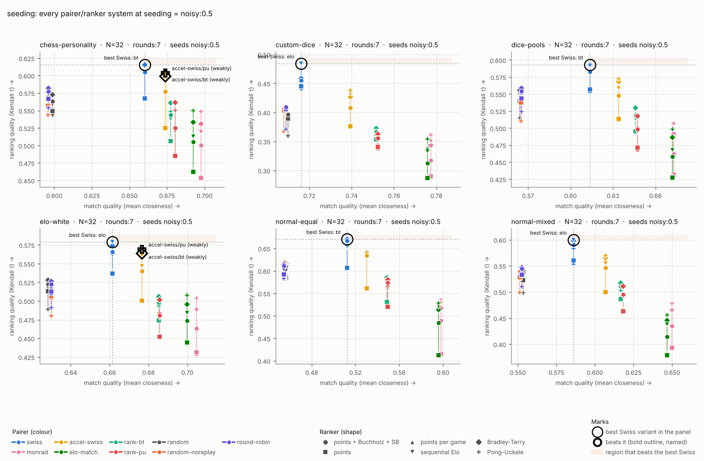

# Study: seeding

What are prior ratings worth? 32 players, 7 rounds, with random seeds (no
information), noisy seeds (true strength z-score + N(0, 0.5)) and perfect
seeds. Swiss uses seeds for its round-1 fold and tiebreaks inside score
groups; accelerated Swiss needs them to mean anything.

Tables: chess-personality, custom-dice, dice-pools, elo-white, normal-equal, normal-mixed. Trials per cell: 300. Bye value: 1.0 points. Seeding: random, noisy:0.5, perfect.

## Match quality vs ranking quality

Every pairer/ranker system at seeding = noisy:0.5, with standard errors. Blue dot: standard Swiss (points, Buchholz, Sonneborn-Berger). Blue ring: the best Swiss variant in that cell (Swiss pairing with whichever ranker ranks best). The shaded quadrant is where a system must land to beat it. Orange dot: beats the best Swiss on both axes (paired |z| >= 3); orange ring: better on one axis, tied on the other.

## Against standard Swiss (swiss/swiss-tb)

Number of cells (out of 18) in each verdict. Per axis a system is better or worse than the reference when the paired difference has |z| >= 3, otherwise tied. *Dominates* = better on both axes; *weakly dominates* = better on one, tied on the other. Top 12 systems.

| system | dominates | weakly dominates | tie | trade-off | weakly dominated | dominated |
|---|---|---|---|---|---|---|
| swiss/bt | 0 | 14 | 4 | 0 | 0 | 0 |
| swiss/elo | 0 | 9 | 3 | 0 | 6 | 0 |
| accel-swiss/pu | 0 | 7 | 4 | 5 | 2 | 0 |
| accel-swiss/bt | 0 | 5 | 4 | 7 | 2 | 0 |
| rank-bt/bt | 0 | 1 | 5 | 12 | 0 | 0 |
| rank-bt/pu | 0 | 1 | 5 | 12 | 0 | 0 |
| rank-bt/swiss-tb | 0 | 1 | 5 | 12 | 0 | 0 |
| rank-pu/bt | 0 | 1 | 5 | 12 | 0 | 0 |
| rank-pu/swiss-tb | 0 | 1 | 4 | 12 | 1 | 0 |
| rank-pu/pu | 0 | 1 | 2 | 12 | 3 | 0 |
| swiss/pu | 0 | 0 | 8 | 0 | 10 | 0 |
| elo-match/bt | 0 | 0 | 6 | 12 | 0 | 0 |

## Against the best Swiss variant in each cell (swiss/best)

Number of cells (out of 18) in each verdict. Per axis a system is better or worse than the reference when the paired difference has |z| >= 3, otherwise tied. *Dominates* = better on both axes; *weakly dominates* = better on one, tied on the other. Top 12 systems.

| system | dominates | weakly dominates | tie | trade-off | weakly dominated | dominated |
|---|---|---|---|---|---|---|
| accel-swiss/pu | 0 | 3 | 4 | 9 | 1 | 1 |
| accel-swiss/bt | 0 | 2 | 4 | 10 | 2 | 0 |
| rank-bt/bt | 0 | 1 | 5 | 12 | 0 | 0 |
| rank-bt/swiss-tb | 0 | 1 | 5 | 12 | 0 | 0 |
| rank-pu/bt | 0 | 1 | 5 | 12 | 0 | 0 |
| rank-bt/pu | 0 | 1 | 4 | 12 | 1 | 0 |
| rank-pu/swiss-tb | 0 | 1 | 3 | 12 | 2 | 0 |
| rank-pu/pu | 0 | 1 | 1 | 12 | 4 | 0 |
| elo-match/bt | 0 | 0 | 6 | 12 | 0 | 0 |
| elo-match/swiss-tb | 0 | 0 | 6 | 12 | 0 | 0 |
| monrad/bt | 0 | 0 | 6 | 12 | 0 | 0 |
| monrad/swiss-tb | 0 | 0 | 6 | 12 | 0 | 0 |

## Per cell: what beats the best Swiss

| table | N | schedule | seeding | best Swiss | beats it (Δτ, Δmq; * = weakly) |
|---|---|---|---|---|---|
| chess-personality | 32 | rounds:7 | noisy:0.5 | swiss/bt | accel-swiss/pu* (-0.012, +0.013), accel-swiss/bt* (-0.016, +0.013) |
| chess-personality | 32 | rounds:7 | perfect | swiss/elo | accel-swiss/pu* (-0.010, +0.014) |
| chess-personality | 32 | rounds:7 | random | swiss/bt | — |
| custom-dice | 32 | rounds:7 | noisy:0.5 | swiss/elo | — |
| custom-dice | 32 | rounds:7 | perfect | swiss/elo | — |
| custom-dice | 32 | rounds:7 | random | swiss/bt | — |
| dice-pools | 32 | rounds:7 | noisy:0.5 | swiss/bt | — |
| dice-pools | 32 | rounds:7 | perfect | swiss/elo | — |
| dice-pools | 32 | rounds:7 | random | swiss/bt | — |
| elo-white | 32 | rounds:7 | noisy:0.5 | swiss/elo | accel-swiss/pu* (-0.010, +0.015), accel-swiss/bt* (-0.015, +0.015) |
| elo-white | 32 | rounds:7 | perfect | swiss/elo | — |
| elo-white | 32 | rounds:7 | random | swiss/bt | — |
| normal-equal | 32 | rounds:7 | noisy:0.5 | swiss/bt | — |
| normal-equal | 32 | rounds:7 | perfect | swiss/bt | — |
| normal-equal | 32 | rounds:7 | random | swiss/bt | rank-pu/bt* (+0.003, +0.005), rank-bt/bt* (-0.002, +0.007), rank-bt/swiss-tb* (-0.008, +0.007) |
| normal-mixed | 32 | rounds:7 | noisy:0.5 | swiss/elo | — |
| normal-mixed | 32 | rounds:7 | perfect | swiss/elo | — |
| normal-mixed | 32 | rounds:7 | random | swiss/bt | — |

## Pareto frontier per cell (by means)

| table | n | schedule | seeding | system | mq | tau | topq | win |
|---|---|---|---|---|---|---|---|---|
| chess-personality | 32 | rounds:7 | noisy:0.5 | swiss/bt | 0.660 | 0.616 | 0.575 | 0.103 |
| chess-personality | 32 | rounds:7 | noisy:0.5 | accel-swiss/pu | 0.674 | 0.604 | 0.557 | 0.150 |
| chess-personality | 32 | rounds:7 | noisy:0.5 | rank-pu/bt | 0.681 | 0.561 | 0.536 | 0.127 |
| chess-personality | 32 | rounds:7 | noisy:0.5 | elo-match/pu | 0.692 | 0.550 | 0.532 | 0.123 |
| chess-personality | 32 | rounds:7 | noisy:0.5 | monrad/pu | 0.698 | 0.549 | 0.538 | 0.153 |
| chess-personality | 32 | rounds:7 | perfect | swiss/elo | 0.647 | 0.633 | 0.591 | 0.173 |
| chess-personality | 32 | rounds:7 | perfect | accel-swiss/pu | 0.661 | 0.622 | 0.585 | 0.150 |
| chess-personality | 32 | rounds:7 | perfect | rank-pu/bt | 0.694 | 0.563 | 0.549 | 0.147 |
| chess-personality | 32 | rounds:7 | perfect | monrad/pu | 0.724 | 0.545 | 0.548 | 0.170 |
| chess-personality | 32 | rounds:7 | random | elo-match/bt | 0.661 | 0.587 | 0.560 | 0.140 |
| chess-personality | 32 | rounds:7 | random | rank-bt/bt | 0.666 | 0.587 | 0.537 | 0.160 |
| custom-dice | 32 | rounds:7 | noisy:0.5 | swiss/elo | 0.716 | 0.484 | 0.593 | 0.213 |
| custom-dice | 32 | rounds:7 | noisy:0.5 | accel-swiss/pu | 0.739 | 0.438 | 0.549 | 0.240 |
| custom-dice | 32 | rounds:7 | noisy:0.5 | rank-bt/bt | 0.752 | 0.373 | 0.510 | 0.250 |
| custom-dice | 32 | rounds:7 | noisy:0.5 | rank-pu/bt | 0.752 | 0.362 | 0.510 | 0.240 |
| custom-dice | 32 | rounds:7 | noisy:0.5 | monrad/pu | 0.777 | 0.361 | 0.487 | 0.240 |
| custom-dice | 32 | rounds:7 | perfect | swiss/elo | 0.702 | 0.511 | 0.609 | 0.210 |
| custom-dice | 32 | rounds:7 | perfect | accel-swiss/pu | 0.735 | 0.445 | 0.568 | 0.267 |
| custom-dice | 32 | rounds:7 | perfect | rank-pu/bt | 0.766 | 0.362 | 0.504 | 0.203 |
| custom-dice | 32 | rounds:7 | perfect | monrad/pu | 0.800 | 0.348 | 0.473 | 0.247 |
| custom-dice | 32 | rounds:7 | random | rank-pu/swiss-tb | 0.730 | 0.412 | 0.532 | 0.237 |
| custom-dice | 32 | rounds:7 | random | monrad/bt | 0.731 | 0.409 | 0.525 | 0.270 |
| custom-dice | 32 | rounds:7 | random | elo-match/swiss-tb | 0.732 | 0.406 | 0.537 | 0.263 |
| dice-pools | 32 | rounds:7 | noisy:0.5 | swiss/bt | 0.614 | 0.593 | 0.673 | 0.217 |
| dice-pools | 32 | rounds:7 | noisy:0.5 | accel-swiss/pu | 0.634 | 0.573 | 0.658 | 0.230 |
| dice-pools | 32 | rounds:7 | noisy:0.5 | rank-bt/bt | 0.646 | 0.530 | 0.613 | 0.203 |
| dice-pools | 32 | rounds:7 | noisy:0.5 | rank-pu/bt | 0.647 | 0.518 | 0.606 | 0.210 |
| dice-pools | 32 | rounds:7 | noisy:0.5 | monrad/pu | 0.673 | 0.507 | 0.586 | 0.213 |
| dice-pools | 32 | rounds:7 | perfect | swiss/elo | 0.594 | 0.616 | 0.666 | 0.207 |
| dice-pools | 32 | rounds:7 | perfect | accel-swiss/pu | 0.622 | 0.598 | 0.655 | 0.250 |
| dice-pools | 32 | rounds:7 | perfect | rank-pu/bt | 0.667 | 0.517 | 0.598 | 0.267 |
| dice-pools | 32 | rounds:7 | perfect | monrad/pu | 0.709 | 0.485 | 0.577 | 0.220 |
| dice-pools | 32 | rounds:7 | random | accel-swiss/bt | 0.622 | 0.568 | 0.641 | 0.207 |
| dice-pools | 32 | rounds:7 | random | swiss/bt | 0.623 | 0.564 | 0.656 | 0.220 |
| dice-pools | 32 | rounds:7 | random | rank-bt/bt | 0.626 | 0.563 | 0.640 | 0.200 |
| elo-white | 32 | rounds:7 | noisy:0.5 | swiss/elo | 0.661 | 0.579 | 0.701 | 0.540 |
| elo-white | 32 | rounds:7 | noisy:0.5 | accel-swiss/pu | 0.677 | 0.569 | 0.696 | 0.460 |
| elo-white | 32 | rounds:7 | noisy:0.5 | elo-match/pu | 0.700 | 0.508 | 0.633 | 0.467 |
| elo-white | 32 | rounds:7 | noisy:0.5 | monrad/pu | 0.705 | 0.504 | 0.634 | 0.473 |
| elo-white | 32 | rounds:7 | perfect | swiss/elo | 0.646 | 0.605 | 0.703 | 0.477 |
| elo-white | 32 | rounds:7 | perfect | accel-swiss/pu | 0.661 | 0.568 | 0.700 | 0.473 |
| elo-white | 32 | rounds:7 | perfect | rank-pu/bt | 0.700 | 0.498 | 0.634 | 0.440 |
| elo-white | 32 | rounds:7 | perfect | monrad/pu | 0.727 | 0.483 | 0.621 | 0.453 |
| elo-white | 32 | rounds:7 | random | rank-bt/bt | 0.671 | 0.540 | 0.669 | 0.470 |
| normal-equal | 32 | rounds:7 | noisy:0.5 | swiss/bt | 0.513 | 0.671 | 0.743 | 0.597 |
| normal-equal | 32 | rounds:7 | noisy:0.5 | accel-swiss/pu | 0.530 | 0.642 | 0.733 | 0.573 |
| normal-equal | 32 | rounds:7 | noisy:0.5 | rank-bt/bt | 0.549 | 0.585 | 0.676 | 0.593 |
| normal-equal | 32 | rounds:7 | noisy:0.5 | rank-pu/bt | 0.550 | 0.580 | 0.679 | 0.533 |
| normal-equal | 32 | rounds:7 | noisy:0.5 | monrad/elo | 0.598 | 0.534 | 0.635 | 0.593 |
| normal-equal | 32 | rounds:7 | perfect | swiss/bt | 0.476 | 0.694 | 0.772 | 0.640 |
| normal-equal | 32 | rounds:7 | perfect | accel-swiss/elo | 0.502 | 0.662 | 0.770 | 0.550 |
| normal-equal | 32 | rounds:7 | perfect | rank-bt/bt | 0.581 | 0.567 | 0.662 | 0.550 |
| normal-equal | 32 | rounds:7 | perfect | rank-pu/bt | 0.584 | 0.547 | 0.644 | 0.550 |
| normal-equal | 32 | rounds:7 | perfect | monrad/elo | 0.662 | 0.503 | 0.633 | 0.597 |
| normal-equal | 32 | rounds:7 | random | rank-pu/bt | 0.532 | 0.638 | 0.731 | 0.560 |
| normal-equal | 32 | rounds:7 | random | rank-bt/bt | 0.533 | 0.633 | 0.718 | 0.607 |
| normal-mixed | 32 | rounds:7 | noisy:0.5 | swiss/elo | 0.586 | 0.600 | 0.666 | 0.437 |
| normal-mixed | 32 | rounds:7 | noisy:0.5 | accel-swiss/pu | 0.607 | 0.570 | 0.657 | 0.443 |
| normal-mixed | 32 | rounds:7 | noisy:0.5 | rank-bt/bt | 0.617 | 0.517 | 0.600 | 0.453 |
| normal-mixed | 32 | rounds:7 | noisy:0.5 | rank-pu/bt | 0.618 | 0.511 | 0.602 | 0.427 |
| normal-mixed | 32 | rounds:7 | noisy:0.5 | monrad/pu | 0.650 | 0.478 | 0.578 | 0.443 |
| normal-mixed | 32 | rounds:7 | perfect | swiss/elo | 0.562 | 0.622 | 0.694 | 0.487 |
| normal-mixed | 32 | rounds:7 | perfect | accel-swiss/pu | 0.590 | 0.576 | 0.674 | 0.457 |
| normal-mixed | 32 | rounds:7 | perfect | rank-bt/bt | 0.639 | 0.497 | 0.586 | 0.460 |
| normal-mixed | 32 | rounds:7 | perfect | rank-pu/bt | 0.643 | 0.495 | 0.588 | 0.440 |
| normal-mixed | 32 | rounds:7 | perfect | monrad/pu | 0.693 | 0.435 | 0.552 | 0.453 |
| normal-mixed | 32 | rounds:7 | random | rank-bt/bt | 0.599 | 0.558 | 0.627 | 0.470 |
