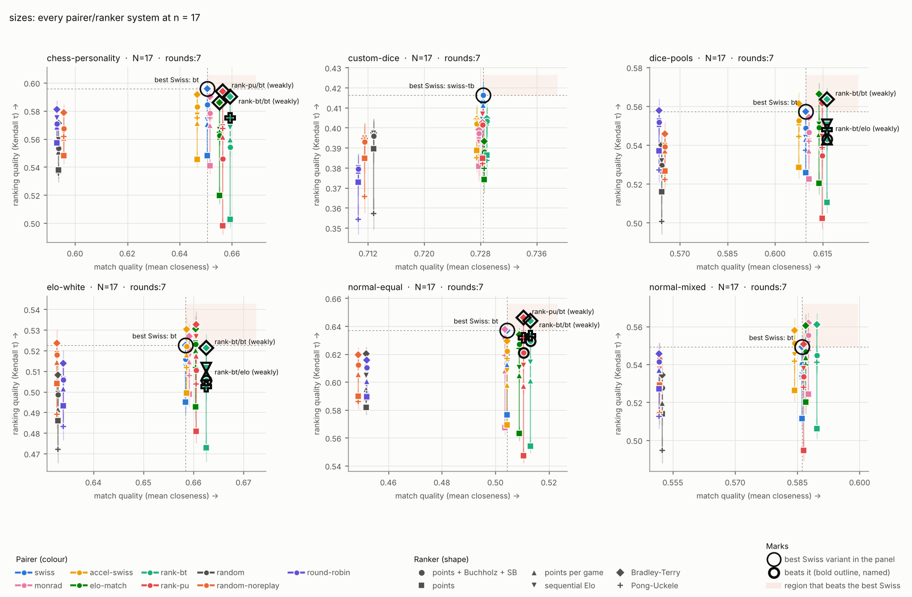
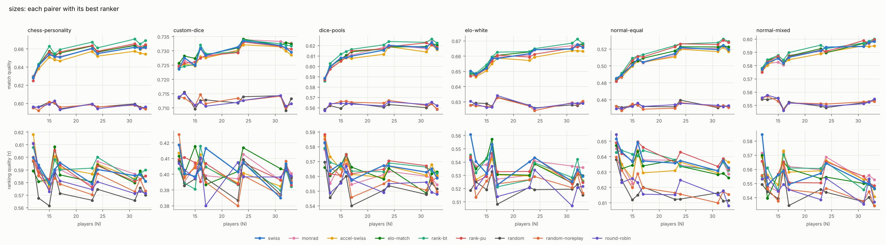
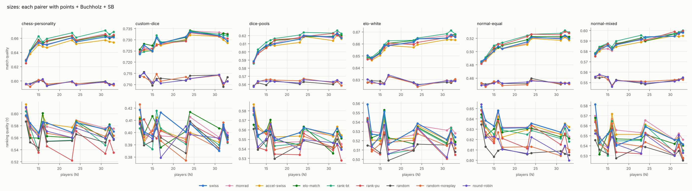

# Study: sizes

How do field size, odd counts (byes) and non-power-of-two counts affect
quality? 7 rounds; N = 12, 13, 15, 16, 17, 23, 24, 31, 32, 33. Odd fields give
one full-point bye per round.

Tables: chess-personality, custom-dice, dice-pools, elo-white, normal-equal, normal-mixed. Trials per cell: 400. Bye value: 1.0 points. Seeding: random.

## Match quality vs ranking quality

Every pairer/ranker system at n = 17, with standard errors. Blue dot: standard Swiss (points, Buchholz, Sonneborn-Berger). Blue ring: the best Swiss variant in that cell (Swiss pairing with whichever ranker ranks best). The shaded quadrant is where a system must land to beat it. Orange dot: beats the best Swiss on both axes (paired |z| >= 3); orange ring: better on one axis, tied on the other.

## Sweep

Each pairer ranked by its best ranker in that cell:

Each pairer ranked by points + Buchholz + SB:

## Against standard Swiss (swiss/swiss-tb)

Number of cells (out of 60) in each verdict. Per axis a system is better or worse than the reference when the paired difference has |z| >= 3, otherwise tied. *Dominates* = better on both axes; *weakly dominates* = better on one, tied on the other. Top 12 systems.

| system | dominates | weakly dominates | tie | trade-off | weakly dominated | dominated |
|---|---|---|---|---|---|---|
| rank-bt/bt | 2 | 19 | 39 | 0 | 0 | 0 |
| swiss/bt | 0 | 34 | 25 | 0 | 1 | 0 |
| rank-bt/pu | 0 | 21 | 27 | 0 | 12 | 0 |
| rank-bt/swiss-tb | 0 | 17 | 38 | 4 | 1 | 0 |
| rank-bt/elo | 0 | 16 | 34 | 5 | 5 | 0 |
| rank-pu/bt | 0 | 8 | 52 | 0 | 0 | 0 |
| rank-bt/pct | 0 | 8 | 22 | 13 | 17 | 0 |
| rank-pu/pu | 0 | 7 | 35 | 0 | 18 | 0 |
| rank-pu/swiss-tb | 0 | 4 | 41 | 3 | 12 | 0 |
| monrad/bt | 0 | 3 | 57 | 0 | 0 | 0 |
| rank-pu/elo | 0 | 3 | 42 | 4 | 11 | 0 |
| elo-match/bt | 0 | 2 | 58 | 0 | 0 | 0 |

## Against the best Swiss variant in each cell (swiss/best)

Number of cells (out of 60) in each verdict. Per axis a system is better or worse than the reference when the paired difference has |z| >= 3, otherwise tied. *Dominates* = better on both axes; *weakly dominates* = better on one, tied on the other. Top 12 systems.

| system | dominates | weakly dominates | tie | trade-off | weakly dominated | dominated |
|---|---|---|---|---|---|---|
| rank-bt/bt | 0 | 21 | 38 | 0 | 1 | 0 |
| rank-bt/pu | 0 | 19 | 25 | 2 | 14 | 0 |
| rank-bt/swiss-tb | 0 | 12 | 36 | 9 | 3 | 0 |
| rank-bt/elo | 0 | 8 | 31 | 13 | 8 | 0 |
| rank-pu/bt | 0 | 7 | 53 | 0 | 0 | 0 |
| rank-pu/pu | 0 | 6 | 23 | 1 | 30 | 0 |
| rank-bt/pct | 0 | 4 | 21 | 17 | 18 | 0 |
| elo-match/bt | 0 | 2 | 58 | 0 | 0 | 0 |
| rank-pu/swiss-tb | 0 | 2 | 33 | 5 | 20 | 0 |
| monrad/bt | 0 | 1 | 59 | 0 | 0 | 0 |
| monrad/swiss-tb | 0 | 1 | 58 | 0 | 1 | 0 |
| elo-match/swiss-tb | 0 | 1 | 49 | 1 | 9 | 0 |

## Per cell: what beats the best Swiss

| table | N | schedule | seeding | best Swiss | beats it (Δτ, Δmq; * = weakly) |
|---|---|---|---|---|---|
| chess-personality | 12 | rounds:7 | random | swiss/bt | — |
| chess-personality | 13 | rounds:7 | random | swiss/bt | — |
| chess-personality | 15 | rounds:7 | random | swiss/bt | rank-bt/bt* (-0.001, +0.009), rank-bt/pu* (-0.013, +0.009) |
| chess-personality | 16 | rounds:7 | random | swiss/bt | — |
| chess-personality | 17 | rounds:7 | random | swiss/bt | rank-pu/bt* (-0.002, +0.006), rank-bt/bt* (-0.006, +0.009), elo-match/bt* (-0.010, +0.005) |
| chess-personality | 23 | rounds:7 | random | swiss/bt | rank-bt/bt* (+0.012, +0.007), rank-bt/pu* (-0.003, +0.007), rank-bt/elo* (-0.012, +0.007) |
| chess-personality | 24 | rounds:7 | random | swiss/bt | rank-bt/bt* (+0.010, +0.006), rank-bt/swiss-tb* (-0.004, +0.006), rank-bt/pu* (-0.009, +0.006) |
| chess-personality | 31 | rounds:7 | random | swiss/bt | rank-bt/bt* (-0.003, +0.009) |
| chess-personality | 32 | rounds:7 | random | swiss/bt | rank-bt/bt* (+0.001, +0.004), rank-bt/pu* (-0.013, +0.004), rank-bt/swiss-tb* (-0.014, +0.004) |
| chess-personality | 33 | rounds:7 | random | swiss/bt | rank-bt/bt* (+0.009, +0.008), rank-bt/pu* (-0.007, +0.008) |
| custom-dice | 12 | rounds:7 | random | swiss/swiss-tb | — |
| custom-dice | 13 | rounds:7 | random | swiss/bt | — |
| custom-dice | 15 | rounds:7 | random | swiss/bt | — |
| custom-dice | 16 | rounds:7 | random | swiss/swiss-tb | — |
| custom-dice | 17 | rounds:7 | random | swiss/swiss-tb | — |
| custom-dice | 23 | rounds:7 | random | swiss/bt | — |
| custom-dice | 24 | rounds:7 | random | swiss/swiss-tb | — |
| custom-dice | 31 | rounds:7 | random | swiss/swiss-tb | — |
| custom-dice | 32 | rounds:7 | random | swiss/swiss-tb | — |
| custom-dice | 33 | rounds:7 | random | swiss/bt | monrad/bt* (+0.006, +0.003), monrad/swiss-tb* (+0.005, +0.003), elo-match/bt* (+0.004, +0.003) |
| dice-pools | 12 | rounds:7 | random | swiss/swiss-tb | — |
| dice-pools | 13 | rounds:7 | random | swiss/bt | — |
| dice-pools | 15 | rounds:7 | random | swiss/bt | — |
| dice-pools | 16 | rounds:7 | random | swiss/bt | rank-bt/bt* (+0.011, +0.006), rank-bt/swiss-tb* (-0.002, +0.006), rank-bt/pu* (-0.007, +0.006) |
| dice-pools | 17 | rounds:7 | random | swiss/bt | rank-bt/bt* (+0.006, +0.007), rank-bt/elo* (-0.007, +0.007), rank-bt/pu* (-0.009, +0.007) |
| dice-pools | 23 | rounds:7 | random | swiss/bt | rank-bt/bt* (-0.004, +0.005) |
| dice-pools | 24 | rounds:7 | random | swiss/bt | — |
| dice-pools | 31 | rounds:7 | random | swiss/bt | rank-bt/bt* (+0.003, +0.005), rank-bt/pu* (-0.014, +0.005), rank-bt/elo* (-0.014, +0.005) |
| dice-pools | 32 | rounds:7 | random | swiss/bt | — |
| dice-pools | 33 | rounds:7 | random | swiss/bt | rank-bt/bt* (+0.003, +0.005), rank-bt/pu* (-0.010, +0.005) |
| elo-white | 12 | rounds:7 | random | swiss/bt | — |
| elo-white | 13 | rounds:7 | random | swiss/bt | — |
| elo-white | 15 | rounds:7 | random | swiss/bt | — |
| elo-white | 16 | rounds:7 | random | swiss/bt | — |
| elo-white | 17 | rounds:7 | random | swiss/bt | rank-bt/bt* (-0.001, +0.004), rank-bt/elo* (-0.011, +0.004), rank-bt/pct* (-0.015, +0.004) |
| elo-white | 23 | rounds:7 | random | swiss/bt | — |
| elo-white | 24 | rounds:7 | random | swiss/bt | — |
| elo-white | 31 | rounds:7 | random | swiss/bt | rank-bt/bt* (+0.003, +0.004), rank-bt/elo* (-0.008, +0.004), rank-bt/swiss-tb* (-0.009, +0.004) |
| elo-white | 32 | rounds:7 | random | swiss/bt | rank-bt/bt* (+0.008, +0.004), rank-bt/swiss-tb* (-0.001, +0.004), rank-bt/elo* (-0.007, +0.004) |
| elo-white | 33 | rounds:7 | random | swiss/bt | — |
| normal-equal | 12 | rounds:7 | random | swiss/swiss-tb | — |
| normal-equal | 13 | rounds:7 | random | swiss/bt | — |
| normal-equal | 15 | rounds:7 | random | swiss/bt | rank-bt/bt* (+0.005, +0.008), rank-bt/pu* (-0.008, +0.008), rank-bt/swiss-tb* (-0.012, +0.008) |
| normal-equal | 16 | rounds:7 | random | swiss/bt | — |
| normal-equal | 17 | rounds:7 | random | swiss/bt | rank-pu/bt* (+0.009, +0.006), rank-bt/bt* (+0.007, +0.009), rank-bt/pu* (-0.004, +0.009) |
| normal-equal | 23 | rounds:7 | random | swiss/bt | rank-bt/bt* (+0.002, +0.009), rank-pu/bt* (+0.000, +0.008), rank-bt/pu* (-0.010, +0.009) |
| normal-equal | 24 | rounds:7 | random | swiss/bt | — |
| normal-equal | 31 | rounds:7 | random | swiss/bt | rank-pu/bt* (+0.003, +0.006), rank-bt/bt* (+0.000, +0.008), rank-pu/pu* (-0.007, +0.006) |
| normal-equal | 32 | rounds:7 | random | swiss/bt | rank-pu/bt* (+0.001, +0.006), rank-bt/bt* (-0.001, +0.007), rank-bt/swiss-tb* (-0.007, +0.007) |
| normal-equal | 33 | rounds:7 | random | swiss/bt | rank-pu/bt* (-0.001, +0.009), rank-bt/bt* (-0.002, +0.010), rank-pu/pu* (-0.009, +0.009) |
| normal-mixed | 12 | rounds:7 | random | swiss/bt | — |
| normal-mixed | 13 | rounds:7 | random | swiss/bt | — |
| normal-mixed | 15 | rounds:7 | random | swiss/bt | — |
| normal-mixed | 16 | rounds:7 | random | swiss/bt | — |
| normal-mixed | 17 | rounds:7 | random | swiss/bt | — |
| normal-mixed | 23 | rounds:7 | random | swiss/bt | — |
| normal-mixed | 24 | rounds:7 | random | swiss/bt | — |
| normal-mixed | 31 | rounds:7 | random | swiss/bt | rank-pu/bt* (+0.004, +0.004), rank-pu/pu* (-0.014, +0.004) |
| normal-mixed | 32 | rounds:7 | random | swiss/bt | — |
| normal-mixed | 33 | rounds:7 | random | swiss/bt | — |

## Pareto frontier per cell (by means)

| table | n | schedule | seeding | system | mq | tau | topq | win |
|---|---|---|---|---|---|---|---|---|
| chess-personality | 12 | rounds:7 | random | accel-swiss/bt | 0.628 | 0.618 | 0.566 | 0.300 |
| chess-personality | 12 | rounds:7 | random | monrad/bt | 0.630 | 0.611 | 0.555 | 0.305 |
| chess-personality | 13 | rounds:7 | random | swiss/bt | 0.642 | 0.594 | 0.560 | 0.268 |
| chess-personality | 13 | rounds:7 | random | rank-bt/bt | 0.643 | 0.592 | 0.535 | 0.278 |
| chess-personality | 15 | rounds:7 | random | elo-match/bt | 0.657 | 0.583 | 0.483 | 0.255 |
| chess-personality | 15 | rounds:7 | random | rank-bt/bt | 0.663 | 0.579 | 0.476 | 0.195 |
| chess-personality | 16 | rounds:7 | random | elo-match/bt | 0.654 | 0.608 | 0.564 | 0.225 |
| chess-personality | 16 | rounds:7 | random | rank-bt/bt | 0.655 | 0.598 | 0.571 | 0.263 |
| chess-personality | 17 | rounds:7 | random | swiss/bt | 0.651 | 0.596 | 0.551 | 0.228 |
| chess-personality | 17 | rounds:7 | random | rank-pu/bt | 0.657 | 0.594 | 0.547 | 0.190 |
| chess-personality | 17 | rounds:7 | random | rank-bt/bt | 0.659 | 0.590 | 0.534 | 0.242 |
| chess-personality | 23 | rounds:7 | random | rank-bt/bt | 0.667 | 0.591 | 0.531 | 0.180 |
| chess-personality | 24 | rounds:7 | random | rank-bt/bt | 0.661 | 0.600 | 0.566 | 0.207 |
| chess-personality | 31 | rounds:7 | random | monrad/bt | 0.664 | 0.587 | 0.523 | 0.158 |
| chess-personality | 31 | rounds:7 | random | rank-bt/bt | 0.671 | 0.582 | 0.526 | 0.125 |
| chess-personality | 32 | rounds:7 | random | elo-match/bt | 0.660 | 0.589 | 0.562 | 0.122 |
| chess-personality | 32 | rounds:7 | random | rank-bt/bt | 0.665 | 0.587 | 0.544 | 0.150 |
| chess-personality | 33 | rounds:7 | random | rank-bt/bt | 0.669 | 0.590 | 0.561 | 0.138 |
| custom-dice | 12 | rounds:7 | random | random-noreplay/bt | 0.714 | 0.425 | 0.541 | 0.350 |
| custom-dice | 12 | rounds:7 | random | swiss/swiss-tb | 0.724 | 0.419 | 0.531 | 0.305 |
| custom-dice | 12 | rounds:7 | random | accel-swiss/bt | 0.724 | 0.413 | 0.532 | 0.350 |
| custom-dice | 12 | rounds:7 | random | elo-match/bt | 0.726 | 0.411 | 0.517 | 0.352 |
| custom-dice | 13 | rounds:7 | random | rank-pu/swiss-tb | 0.726 | 0.411 | 0.525 | 0.323 |
| custom-dice | 13 | rounds:7 | random | swiss/bt | 0.728 | 0.400 | 0.507 | 0.352 |
| custom-dice | 13 | rounds:7 | random | swiss/swiss-tb | 0.728 | 0.400 | 0.509 | 0.350 |
| custom-dice | 13 | rounds:7 | random | elo-match/bt | 0.728 | 0.400 | 0.510 | 0.347 |
| custom-dice | 15 | rounds:7 | random | elo-match/bt | 0.727 | 0.418 | 0.497 | 0.333 |
| custom-dice | 16 | rounds:7 | random | rank-bt/swiss-tb | 0.732 | 0.418 | 0.534 | 0.275 |
| custom-dice | 17 | rounds:7 | random | swiss/swiss-tb | 0.728 | 0.416 | 0.519 | 0.287 |
| custom-dice | 17 | rounds:7 | random | rank-bt/bt | 0.729 | 0.405 | 0.512 | 0.285 |
| custom-dice | 23 | rounds:7 | random | round-robin/bt | 0.712 | 0.407 | 0.509 | 0.233 |
| custom-dice | 23 | rounds:7 | random | elo-match/bt | 0.731 | 0.402 | 0.509 | 0.273 |
| custom-dice | 23 | rounds:7 | random | swiss/bt | 0.731 | 0.401 | 0.495 | 0.300 |
| custom-dice | 24 | rounds:7 | random | elo-match/swiss-tb | 0.734 | 0.417 | 0.555 | 0.255 |
| custom-dice | 31 | rounds:7 | random | elo-match/swiss-tb | 0.732 | 0.403 | 0.509 | 0.210 |
| custom-dice | 31 | rounds:7 | random | monrad/swiss-tb | 0.733 | 0.396 | 0.521 | 0.235 |
| custom-dice | 32 | rounds:7 | random | random-noreplay/swiss-tb | 0.710 | 0.408 | 0.535 | 0.223 |
| custom-dice | 32 | rounds:7 | random | swiss/swiss-tb | 0.731 | 0.407 | 0.541 | 0.230 |
| custom-dice | 32 | rounds:7 | random | monrad/bt | 0.733 | 0.406 | 0.525 | 0.275 |
| custom-dice | 32 | rounds:7 | random | elo-match/swiss-tb | 0.733 | 0.402 | 0.537 | 0.270 |
| custom-dice | 33 | rounds:7 | random | monrad/bt | 0.733 | 0.400 | 0.525 | 0.245 |
| dice-pools | 12 | rounds:7 | random | rank-pu/bt | 0.587 | 0.588 | 0.649 | 0.395 |
| dice-pools | 12 | rounds:7 | random | accel-swiss/bt | 0.588 | 0.587 | 0.646 | 0.412 |
| dice-pools | 12 | rounds:7 | random | swiss/swiss-tb | 0.588 | 0.583 | 0.643 | 0.388 |
| dice-pools | 13 | rounds:7 | random | accel-swiss/bt | 0.598 | 0.573 | 0.624 | 0.405 |
| dice-pools | 13 | rounds:7 | random | rank-bt/bt | 0.603 | 0.569 | 0.625 | 0.393 |
| dice-pools | 15 | rounds:7 | random | monrad/bt | 0.608 | 0.569 | 0.593 | 0.378 |
| dice-pools | 15 | rounds:7 | random | swiss/bt | 0.608 | 0.568 | 0.608 | 0.328 |
| dice-pools | 15 | rounds:7 | random | rank-bt/bt | 0.612 | 0.567 | 0.563 | 0.365 |
| dice-pools | 16 | rounds:7 | random | elo-match/bt | 0.610 | 0.575 | 0.634 | 0.365 |
| dice-pools | 16 | rounds:7 | random | rank-bt/bt | 0.614 | 0.574 | 0.637 | 0.370 |
| dice-pools | 17 | rounds:7 | random | elo-match/bt | 0.614 | 0.566 | 0.624 | 0.305 |
| dice-pools | 17 | rounds:7 | random | rank-bt/bt | 0.616 | 0.563 | 0.636 | 0.312 |
| dice-pools | 23 | rounds:7 | random | swiss/bt | 0.615 | 0.567 | 0.618 | 0.285 |
| dice-pools | 23 | rounds:7 | random | rank-pu/bt | 0.617 | 0.565 | 0.610 | 0.268 |
| dice-pools | 23 | rounds:7 | random | rank-bt/bt | 0.621 | 0.563 | 0.612 | 0.265 |
| dice-pools | 24 | rounds:7 | random | rank-pu/bt | 0.619 | 0.570 | 0.647 | 0.228 |
| dice-pools | 24 | rounds:7 | random | rank-bt/bt | 0.624 | 0.569 | 0.644 | 0.225 |
| dice-pools | 31 | rounds:7 | random | rank-pu/bt | 0.623 | 0.567 | 0.624 | 0.225 |
| dice-pools | 31 | rounds:7 | random | rank-bt/bt | 0.623 | 0.566 | 0.628 | 0.233 |
| dice-pools | 32 | rounds:7 | random | accel-swiss/bt | 0.621 | 0.568 | 0.640 | 0.207 |
| dice-pools | 32 | rounds:7 | random | swiss/bt | 0.623 | 0.565 | 0.655 | 0.230 |
| dice-pools | 32 | rounds:7 | random | rank-bt/bt | 0.626 | 0.563 | 0.635 | 0.210 |
| dice-pools | 33 | rounds:7 | random | elo-match/bt | 0.621 | 0.563 | 0.637 | 0.182 |
| dice-pools | 33 | rounds:7 | random | rank-bt/bt | 0.622 | 0.562 | 0.623 | 0.217 |
| elo-white | 12 | rounds:7 | random | swiss/bt | 0.650 | 0.561 | 0.664 | 0.565 |
| elo-white | 13 | rounds:7 | random | swiss/bt | 0.648 | 0.540 | 0.682 | 0.560 |
| elo-white | 13 | rounds:7 | random | rank-bt/bt | 0.649 | 0.532 | 0.661 | 0.530 |
| elo-white | 15 | rounds:7 | random | elo-match/bt | 0.653 | 0.543 | 0.656 | 0.500 |
| elo-white | 15 | rounds:7 | random | rank-bt/bt | 0.654 | 0.542 | 0.647 | 0.507 |
| elo-white | 16 | rounds:7 | random | elo-match/bt | 0.659 | 0.557 | 0.673 | 0.555 |
| elo-white | 16 | rounds:7 | random | rank-bt/bt | 0.659 | 0.550 | 0.674 | 0.527 |
| elo-white | 17 | rounds:7 | random | rank-pu/bt | 0.661 | 0.533 | 0.658 | 0.512 |
| elo-white | 17 | rounds:7 | random | rank-bt/bt | 0.663 | 0.521 | 0.646 | 0.460 |
| elo-white | 23 | rounds:7 | random | swiss/bt | 0.662 | 0.540 | 0.655 | 0.520 |
| elo-white | 23 | rounds:7 | random | elo-match/bt | 0.663 | 0.530 | 0.652 | 0.487 |
| elo-white | 23 | rounds:7 | random | rank-bt/bt | 0.663 | 0.526 | 0.657 | 0.515 |
| elo-white | 24 | rounds:7 | random | rank-pu/bt | 0.661 | 0.543 | 0.665 | 0.502 |
| elo-white | 24 | rounds:7 | random | swiss/bt | 0.664 | 0.543 | 0.672 | 0.460 |
| elo-white | 24 | rounds:7 | random | rank-bt/bt | 0.665 | 0.539 | 0.662 | 0.487 |
| elo-white | 31 | rounds:7 | random | monrad/bt | 0.667 | 0.537 | 0.656 | 0.480 |
| elo-white | 31 | rounds:7 | random | rank-bt/bt | 0.668 | 0.528 | 0.652 | 0.485 |
| elo-white | 32 | rounds:7 | random | rank-bt/bt | 0.671 | 0.542 | 0.670 | 0.470 |
| elo-white | 33 | rounds:7 | random | monrad/bt | 0.668 | 0.536 | 0.670 | 0.520 |
| elo-white | 33 | rounds:7 | random | rank-bt/bt | 0.668 | 0.525 | 0.672 | 0.465 |
| normal-equal | 12 | rounds:7 | random | round-robin/bt | 0.449 | 0.654 | 0.735 | 0.555 |
| normal-equal | 12 | rounds:7 | random | swiss/swiss-tb | 0.485 | 0.652 | 0.708 | 0.570 |
| normal-equal | 13 | rounds:7 | random | rank-bt/bt | 0.491 | 0.644 | 0.716 | 0.608 |
| normal-equal | 15 | rounds:7 | random | rank-bt/bt | 0.509 | 0.642 | 0.701 | 0.568 |
| normal-equal | 16 | rounds:7 | random | rank-pu/bt | 0.511 | 0.650 | 0.725 | 0.570 |
| normal-equal | 16 | rounds:7 | random | rank-bt/bt | 0.511 | 0.640 | 0.728 | 0.575 |
| normal-equal | 17 | rounds:7 | random | rank-pu/bt | 0.510 | 0.646 | 0.728 | 0.583 |
| normal-equal | 17 | rounds:7 | random | rank-bt/bt | 0.513 | 0.644 | 0.714 | 0.595 |
| normal-equal | 23 | rounds:7 | random | rank-bt/bt | 0.524 | 0.638 | 0.701 | 0.570 |
| normal-equal | 24 | rounds:7 | random | rank-pu/bt | 0.526 | 0.643 | 0.730 | 0.588 |
| normal-equal | 31 | rounds:7 | random | rank-pu/bt | 0.525 | 0.634 | 0.706 | 0.573 |
| normal-equal | 31 | rounds:7 | random | rank-bt/bt | 0.527 | 0.631 | 0.711 | 0.547 |
| normal-equal | 32 | rounds:7 | random | accel-swiss/bt | 0.522 | 0.639 | 0.730 | 0.560 |
| normal-equal | 32 | rounds:7 | random | rank-pu/bt | 0.530 | 0.639 | 0.733 | 0.573 |
| normal-equal | 32 | rounds:7 | random | rank-bt/bt | 0.532 | 0.637 | 0.722 | 0.603 |
| normal-equal | 33 | rounds:7 | random | accel-swiss/bt | 0.517 | 0.636 | 0.717 | 0.570 |
| normal-equal | 33 | rounds:7 | random | swiss/bt | 0.519 | 0.633 | 0.719 | 0.550 |
| normal-equal | 33 | rounds:7 | random | rank-pu/bt | 0.528 | 0.632 | 0.714 | 0.583 |
| normal-equal | 33 | rounds:7 | random | rank-bt/bt | 0.529 | 0.631 | 0.718 | 0.565 |
| normal-mixed | 12 | rounds:7 | random | swiss/bt | 0.577 | 0.585 | 0.667 | 0.515 |
| normal-mixed | 12 | rounds:7 | random | monrad/bt | 0.578 | 0.572 | 0.639 | 0.495 |
| normal-mixed | 12 | rounds:7 | random | elo-match/bt | 0.578 | 0.570 | 0.657 | 0.537 |
| normal-mixed | 13 | rounds:7 | random | rank-bt/bt | 0.584 | 0.561 | 0.624 | 0.482 |
| normal-mixed | 15 | rounds:7 | random | rank-pu/bt | 0.587 | 0.557 | 0.598 | 0.517 |
| normal-mixed | 15 | rounds:7 | random | rank-bt/bt | 0.588 | 0.545 | 0.583 | 0.520 |
| normal-mixed | 16 | rounds:7 | random | accel-swiss/bt | 0.581 | 0.573 | 0.645 | 0.497 |
| normal-mixed | 16 | rounds:7 | random | rank-bt/bt | 0.584 | 0.570 | 0.642 | 0.458 |
| normal-mixed | 17 | rounds:7 | random | monrad/bt | 0.588 | 0.562 | 0.629 | 0.458 |
| normal-mixed | 17 | rounds:7 | random | rank-bt/bt | 0.590 | 0.561 | 0.636 | 0.468 |
| normal-mixed | 23 | rounds:7 | random | rank-bt/bt | 0.595 | 0.561 | 0.623 | 0.470 |
| normal-mixed | 24 | rounds:7 | random | monrad/bt | 0.591 | 0.569 | 0.637 | 0.453 |
| normal-mixed | 24 | rounds:7 | random | rank-bt/bt | 0.593 | 0.565 | 0.643 | 0.470 |
| normal-mixed | 24 | rounds:7 | random | swiss/bt | 0.594 | 0.564 | 0.644 | 0.425 |
| normal-mixed | 31 | rounds:7 | random | rank-pu/bt | 0.599 | 0.555 | 0.616 | 0.465 |
| normal-mixed | 32 | rounds:7 | random | monrad/bt | 0.598 | 0.556 | 0.642 | 0.455 |
| normal-mixed | 32 | rounds:7 | random | rank-bt/bt | 0.598 | 0.551 | 0.628 | 0.463 |
| normal-mixed | 33 | rounds:7 | random | monrad/bt | 0.599 | 0.553 | 0.632 | 0.425 |
| normal-mixed | 33 | rounds:7 | random | rank-pu/bt | 0.600 | 0.548 | 0.638 | 0.435 |
| normal-mixed | 33 | rounds:7 | random | rank-bt/bt | 0.600 | 0.546 | 0.622 | 0.443 |
